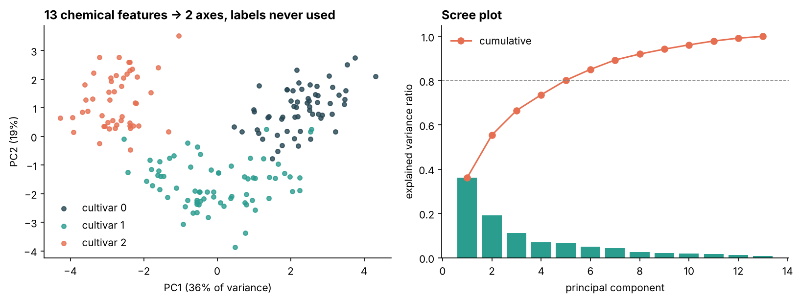
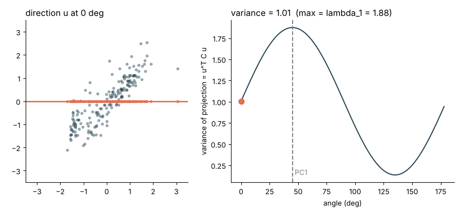

# Lesson 2 · Social Pack: Randomness, Linear Algebra & PCA from Scratch

---

## A. Write-up template

```markdown
# PCA Is an Eigenvalue Problem (and I Can Show You)
*ML Engineer Journey: Phase 1, Lesson 2 · Benson M. Merita*

## The problem
The Wine dataset has 178 wines described by 13 chemical measurements.
Nobody can picture 13 dimensions. Can I compress it to 2 without using
the wine labels, and still see the three grape cultivars?

## The approach
- Standardised every feature (units ranged from 0.1 to 300+)
- Derived PCA: maximise uᵀCu subject to ‖u‖ = 1 → Lagrangian → Cu = λu
- Built a `PCAScratch` class (fit / transform / inverse_transform) with NumPy's `eigh`
- Verified against scikit-learn's PCA (identical up to sign, as theory predicts)
- Bonus: used the condition number to explain why two correlated features gave
  unstable regression weights in Lesson 1 (κ fell from 21.7 to 6.8 after dropping one)

## Results
- PC1 + PC2 keep 55% of the variance; 5 components keep 80%
- The three cultivars separate clearly in 2-D, and the labels were never used
- Reconstruction error with 2 components = exactly the variance discarded (0.446)




## Key takeaways
1. A principal component is the direction of maximum variance, i.e. the top eigenvector of the covariance matrix.
2. Eigenvectors have no fixed sign, so mirrored PCA plots are both correct.
3. Always scale before PCA, and always seed your randomness.

## Code
[Notebook link]
```

---

## B. Video script (≈ 80 seconds, 9:16)

| Time | On screen | Voice-over |
|------|-----------|------------|
| 0–5 s | `rotating_axis.gif`: the line sweeping, variance curve rising | **Hook:** "Watch this line rotate. The moment the bar peaks, you've found the most important direction in your data." |
| 5–20 s | Table of 13 wine features | "This dataset describes 178 wines with 13 chemical measurements. You can't plot 13 dimensions. PCA asks: which direction holds the most spread?" |
| 20–40 s | Handwritten: maximise uᵀCu, ‖u‖=1 → Cu = λu | "As a maths grad, here's the punchline. Maximise the variance under a unit-length constraint, use a Lagrange multiplier, and you get an eigenvalue equation. The best direction is the top eigenvector, and its variance is the eigenvalue." |
| 40–60 s | **Demo moment:** screen-record `wine_pca_3d.html`, rotating the 3-D cloud, then cut to the 2-D scatter | "I coded it from scratch in NumPy. Thirteen features down to two axes, and three grape varieties separate on their own. The model never saw the labels." |
| 60–72 s | sklearn vs mine: "components equal up to sign: True" | "Checked against scikit-learn: identical, up to a sign flip. That's not a bug. Eigenvectors don't have a preferred direction." |
| 72–80 s | Face / GitHub | **CTA:** "Lesson 2 of mathematician to ML engineer. Next up: Pandas. Follow along." |

---

## C. Interactive demo ideas
1. **`assets/rotating_axis.gif`**: already made. Post it as-is on X/LinkedIn (GIFs autoplay).
2. **`assets/wine_pca_3d.html`**: open in a browser, rotate with your mouse, and screen-record (`Win + Alt + R`).
3. **`assets/wine_pca.png`**: scatter + scree plot for a carousel post.
4. **Exercise 5 before/after:** digits reconstructed with 5 / 10 / 20 components next to the originals. "How much of an image is really information?" works well as a TikTok.
5. **Slider idea (Plotly):** a slider for k (1–13) showing the reconstruction error dropping. Reuse the slider pattern from `lesson01 … loss_slider`.

---

## D. Captions & hashtags

**LinkedIn**
> Lesson 2 of my mathematician → ML engineer journey: PCA from scratch.
> The core idea fits in one line: maximise uᵀCu subject to ‖u‖=1, and a Lagrange multiplier turns it into Cu = λu. The best direction in your data is an eigenvector.
> I built it in NumPy, compressed 13 wine features into 2, and the 3 grape varieties separated without the model ever seeing a label. Matched scikit-learn exactly (up to a sign flip, which is expected).
> GIF below: the variance peaks exactly at the first eigenvector 👇
> #MachineLearning #LinearAlgebra #PCA #Python #DataScience #LearningInPublic #KenyaTech

**X / Twitter**
> PCA in one line:
> max uᵀCu s.t. ‖u‖=1 ⟹ Cu = λu
> The rotating line below peaks exactly at the top eigenvector. Built from scratch in NumPy, 13 dims → 2, labels never used 🍷🧵
> #MachineLearning #Python #MathTwitter

**Instagram / TikTok**
> 13 dimensions → 2. One eigenvector. Zero labels. 🍷📐 #machinelearning #linearalgebra #python #mathtok #datascience #techkenya
