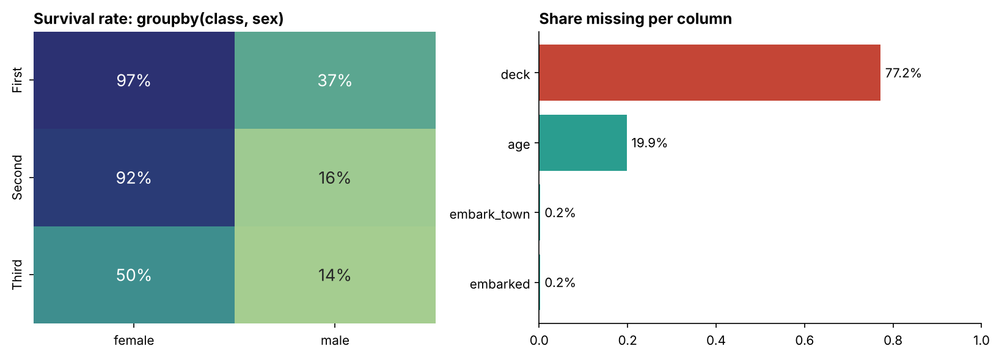

# Lesson 3 · Social Pack: Pandas for ML (groupby Is Linear Algebra)

---

## A. Write-up template

```markdown
# Your groupby() Is Secretly a Regression
*ML Engineer Journey: Phase 1, Lesson 3 · Benson M. Merita*

## The problem
Models need a clean numeric matrix X and target y. Real data (Titanic: 891
passengers) has text categories, 20% missing ages, a 77%-missing column, and
columns that leak the answer. I turned it into a model-ready X and y,
and found some linear algebra along the way.

## The approach
- Inspected dtypes, missingness and leakage (`alive` = the target in disguise)
- Computed survival by class three ways: NumPy `bincount`, least squares
  (GᵀG)⁻¹Gᵀy on a one-hot matrix, and Pandas `groupby`. All identical.
- Showed the dummy-variable trap: intercept + all dummies → rank 3 of 4,
  condition number ≈ 4×10¹⁶. Fixed with drop_first.
- Engineered features with groupby().transform (fare relative to class median),
  merged a ports lookup with `validate="many_to_one"`, and flagged missing ages
- Exported X (891×9, all numeric, no NaNs) aligned with y

## Results
- Survival: First 63%, Second 47%, Third 24%; women in First class 97%
- Passengers with unknown age survived less (29% vs 41%), so missingness is a feature
- scikit-learn's OneHotEncoder + LinearRegression reproduced my numbers exactly



## Key takeaways
1. Group means = least-squares regression on one-hot features.
2. Intercept + every dummy = singular matrix. Drop one level.
3. Check row counts after every merge, and hunt for leakage before modelling.

## Code
[Notebook link]
```

---

## B. Video script (≈ 75 seconds, 9:16)

| Time | On screen | Voice-over |
|------|-----------|------------|
| 0–5 s | `df.groupby("class")["survived"].mean()` next to `(GᵀG)⁻¹Gᵀy` | **Hook:** "This line of Pandas and this equation give the exact same answer. Here's why." |
| 5–20 s | Heatmap: 97% vs 14% | "Titanic survival by class and sex. Women in first class: 97%. Men in third: 14%. Every analyst computes this with groupby." |
| 20–40 s | Build G: rows of 0s and 1s, then GᵀG as a diagonal of counts | "But write each passenger's class as a one-hot row. Gᵀ times G is just the count of each class, Gᵀy is the survivors, and solving the normal equations gives… the group averages. A regression on one category just learns the group means." |
| 40–58 s | **Demo moment:** record `titanic_sunburst.html`, clicking First → female → survived | "Then the trap. Add an intercept plus every category and the matrix becomes singular. The condition number hits ten to the sixteen. Drop one category and it's fixed." |
| 58–68 s | Missingness bar + "alive = survived" callout | "Two more lessons: 77% of 'deck' is missing, and one column, 'alive', is literally the answer. Leave that in and your model looks perfect but has learned nothing." |
| 68–75 s | Face / GitHub | **CTA:** "Lesson 3 of mathematician to ML engineer. Code on GitHub. Next up: visualisation." |

---

## C. Interactive demo ideas
1. **`assets/titanic_sunburst.html`**: click through class → sex → outcome and screen-record it (`Win + Alt + R`).
2. **`assets/titanic_overview.png`**: heatmap + missingness, good for a LinkedIn carousel.
3. **Dummy-trap reveal (Plotly / Streamlit):** a checkbox for "include all dummies". Show the matrix rank and condition number switching between 3 / ~10¹⁶ and 3 / small.
4. **Leak demo (Exercise 5):** a bar chart of R² with and without `alive`. "The model that scores 1.0 is the worst one" makes a strong hook.

---

## D. Captions & hashtags

**LinkedIn**
> Lesson 3 of mathematician → ML engineer: Pandas for ML.
> Something I didn't expect: df.groupby("class").mean() is a least-squares regression. One-hot the category into a matrix G, solve (GᵀG)⁻¹Gᵀy, and you get the group means.
> Add an intercept plus every dummy and the matrix becomes singular (condition number ~10¹⁶). That's the "dummy-variable trap", and it's why drop_first exists.
> Also found: a column that leaks the target, and missing ages that predict survival.
> #MachineLearning #Pandas #Python #DataScience #FeatureEngineering #LearningInPublic #KenyaTech

**X / Twitter**
> groupby().mean() = (GᵀG)⁻¹Gᵀy
> A regression on one categorical feature just learns the group averages. Add an intercept + all dummies → singular matrix. Lesson 3 🧵
> #Python #Pandas #MachineLearning

**Instagram / TikTok**
> Your groupby is secretly a regression 🤯🚢 #python #pandas #datascience #machinelearning #mathtok #techkenya
