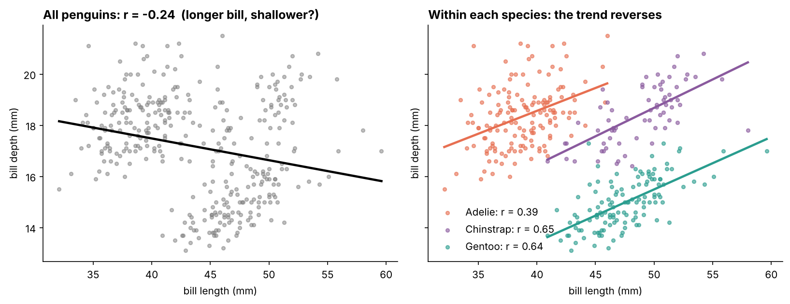

# Lesson 4 · Social Pack: Visualisation for EDA

---

## A. Write-up template

```markdown
# The Correlation That Lied: Simpson's Paradox in Penguin Data
*ML Engineer Journey: Phase 1, Lesson 4 · Benson M. Merita*

## The problem
Before training any model, EDA has to answer: what does each feature look
like, how do features relate, and what could mislead me? I explored the
Palmer Penguins dataset (342 penguins, 3 species, 4 body measurements).

## The approach
- Matplotlib's object model (fig, ax) for controllable multi-panel charts
- Built a kernel density estimator from scratch: one broadcasting line,
  (m,1) grid minus (n,) data, verified against scipy
- Chose histogram bins (Freedman–Diaconis) and KDE bandwidth (Silverman) by formula
- Correlation matrix from scratch as ZᵀZ/(n−1), matching pandas exactly
- Group-aware plots with seaborn (hue=species)

## Results
- Flipper length is bimodal, and the two humps turn out to be species
- KDE bandwidth is a bias–variance trade-off: h=0.5 overfits, h=15 hides both peaks
- **Simpson's paradox:** bill length vs depth has r = −0.24 overall but
  +0.39 / +0.65 / +0.64 within each species



## Key takeaways
1. Plot distributions; don't trust summary statistics alone.
2. Smoothing choices = bias vs variance, the same dilemma as every ML model.
3. Always break correlations down by group before trusting them.

## Code
[Notebook link]
```

---

## B. Video script (≈ 75 seconds, 9:16)

| Time | On screen | Voice-over |
|------|-----------|------------|
| 0–5 s | Left panel of `simpsons_paradox.png`: falling line | **Hook:** "Penguins with longer bills have shallower bills. The data says so. And the data is wrong." |
| 5–20 s | Correlation matrix with −0.24 highlighted | "Across 342 Antarctic penguins, bill length and depth correlate at minus 0.24. Most analysts would stop there." |
| 20–35 s | Right panel: three rising lines appear | "Now colour by species. Inside every species the trend goes up, from 0.39 to 0.65. The overall negative trend comes only from differences between species. That's Simpson's paradox." |
| 35–55 s | **Demo moment:** play `kde_bandwidth.gif` or drag the slider in `kde_slider.html` | "Second lesson: smoothing. A density curve with a tiny bandwidth chases every point. That's overfitting. Too wide and two real peaks merge into one. That's underfitting. Every ML model faces this same trade-off." |
| 55–68 s | Code: `(grid[:, None] - data[None, :]) / h` | "I built the density estimator from scratch: one line of NumPy broadcasting, and it matches scipy exactly." |
| 68–75 s | Face / GitHub | **CTA:** "Lesson 4 of mathematician to ML engineer. Always split by group. Code on GitHub." |

---

## C. Interactive demo ideas
1. **`assets/simpsons_paradox.png`**: your strongest standalone post this week.
2. **`assets/kde_bandwidth.gif`**: loops automatically on X/LinkedIn. Caption: "overfit → just right → underfit".
3. **`assets/kde_slider.html`**: screen-record yourself dragging the bandwidth slider.
4. **Exercise 4 chart:** leave-one-out log-likelihood against h with the best h marked. "I let the data choose its own smoothing" leads nicely into a cross-validation post.
5. **Streamlit idea (later):** a dropdown to pick any two features, plus a checkbox "split by species" that toggles between the overall and within-species regression lines.

---

## D. Captions & hashtags

**LinkedIn**
> Lesson 4 of my mathematician → ML engineer journey: EDA, and a correlation that lied.
> Bill length vs bill depth across 342 penguins: r = −0.24. Split by species: +0.39, +0.65, +0.64. The overall trend points the opposite way to the real one inside every group: Simpson's paradox, explained by the law of total covariance.
> I also built a kernel density estimator from scratch. Its bandwidth is a bias–variance trade-off in miniature (GIF below).
> Lesson: always look at your data by group before you model it.
> #DataScience #MachineLearning #EDA #Statistics #Python #LearningInPublic #KenyaTech

**X / Twitter**
> r = −0.24 overall.
> r = +0.39, +0.65, +0.64 within each species.
> Same penguins. Simpson's paradox 🐧📉📈
> Plus a KDE from scratch: bandwidth = bias–variance in one GIF 🧵 #DataScience #Python

**Instagram / TikTok**
> The data said penguins with longer bills have shallower bills. The data lied. 🐧 #datascience #statistics #python #mathtok #machinelearning #techkenya
