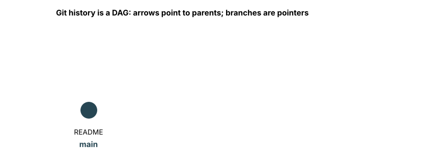

# Lesson 5 · Social Pack: Git Is a Hash Function and a Graph

---

## A. Write-up template

```markdown
# I Rebuilt Git's Core in 60 Lines of Python (and Got the Same Commit IDs)
*ML Engineer Journey: Phase 1, Lesson 5 · Benson M. Merita*

## The problem
Every ML team works through Git, but most people only memorise commands.
I wanted to understand what a commit actually *is*.

## The approach
- Hashed file contents the way Git does: sha1("blob <len>\0" + content)
- Built trees (folder snapshots) and commits (tree + parents + author + time + message)
- Modelled history as a DAG: branches are pointers, merges have two parents,
  merge base = latest common ancestor (set intersection)
- Wrote a diff from scratch: longest common subsequence via dynamic programming
- Verified against real Git: my blob, tree and commit IDs match byte for byte

## Results
- `hash_object` = `git hash-object` ✔ · tree ID ✔ · commit ID ✔
- Tamper test: editing one old file breaks verification of every later commit
- Created and resolved a real merge conflict
- My whole learning journey is now on GitHub: [repo link]



## Key takeaways
1. A commit ID is a hash of its snapshot *and* all of its history, which makes history tamper-evident.
2. A branch is a 40-character pointer, so branching is free. Branch for every idea.
3. The same "hash the content" idea powers data and model versioning in MLOps.
```

---

## B. Video script (≈ 70 seconds, 9:16)

| Time | On screen | Voice-over |
|------|-----------|------------|
| 0–5 s | Two terminals: `git hash-object` and the Python output, same hash highlighted | **Hook:** "Left: Git. Right: 10 lines of my own Python. Same ID, byte for byte." |
| 5–20 s | Formula: sha1("blob" + length + content) | "Git doesn't name files by their names. It names them by a hash of their contents. Change one character and the whole ID scrambles." |
| 20–38 s | **Demo moment:** `commit_graph.gif` building up | "Each commit hashes its snapshot plus its parent's ID, so every commit depends on the entire history. Branches? Just pointers. A merge? A commit with two parents. It's a graph." |
| 38–52 s | Notebook: editing an old file → red `ValueError: corrupt history` | "I tried secretly editing an old file. Verification failed immediately. That's why you can trust Git history, and it's the same idea behind blockchains." |
| 52–62 s | Scroll your GitHub repo page | "Then I put my whole ML journey on GitHub, with branches, pull requests and a resolved merge conflict." |
| 62–70 s | Face | **CTA:** "Lesson 5 of mathematician to ML engineer. Link to the repo in my bio." |

---

## C. Interactive demo ideas
1. **`assets/commit_graph.gif`**: the history DAG growing, then merging.
2. **Side-by-side terminal recording:** `git hash-object a.txt` in Git Bash next to the notebook cell. Seeing the same hash in both is the hook.
3. **"One character" demo:** hash `hello ML` vs `hello ML!` live, showing 1 of 40 hex digits in common.
4. **Exercise 5 chart:** your commit activity per day, a "consistency" post you can update every week.
5. **GitHub tour:** a 15-second screen recording of your pinned repo, README roadmap, and a merged pull request.

---

## D. Captions & hashtags

**LinkedIn**
> Lesson 5 of my mathematician → ML engineer journey: what Git actually is.
> A commit ID = SHA-1 of (snapshot + parent IDs + author + time + message). Every commit hashes its entire past, so history is a tamper-evident directed acyclic graph. Branches are just pointers.
> I rebuilt the core in Python and matched real Git's blob, tree and commit IDs byte for byte. Then I put my whole learning journey on GitHub 👇 [repo link]
> #Git #GitHub #MachineLearning #Python #SoftwareEngineering #LearningInPublic #KenyaTech

**X / Twitter**
> git commit = sha1(tree + parents + author + time + message)
> I rebuilt it in Python. Same commit ID as real Git, byte for byte. History is a Merkle DAG; branches are 40-char pointers 🧵 [repo link]
> #Git #Python #100DaysOfCode

**Instagram / TikTok**
> I rebuilt Git in Python and it produced the exact same IDs 🤯 #git #python #coding #softwareengineering #machinelearning #techkenya
