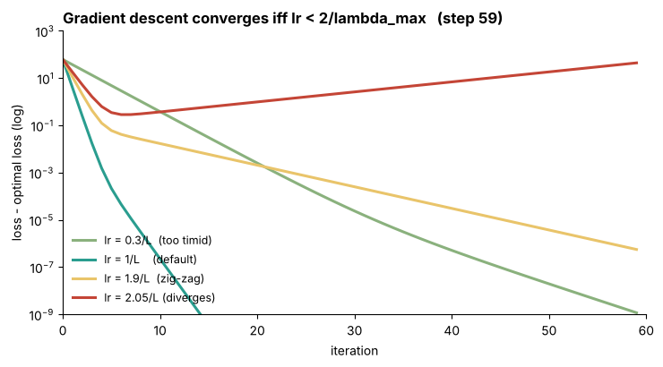

# Lesson 6 · Social Pack: From Notebook Code to a Tested ML Package

---

## A. Write-up template

```markdown
# My From-Scratch ML Code Now Passes scikit-learn's Own Test Suite
*ML Engineer Journey: Phase 1, Lesson 6 · Benson M. Merita*

## The problem
Scratch algorithms trapped in notebooks can't be reused, tested or trusted.
I turned mine into `mlscratch`, a small installable Python package that follows
the scikit-learn estimator API.

## The approach
- Package layout: `mlscratch/` (preprocessing, linear_model, decomposition, metrics),
  `tests/`, `pyproject.toml` (installable with `pip install -e .`)
- The API contract: `__init__` stores params; `fit` learns `attr_` and returns self;
  `transform`/`predict` validate input; mixins give fit_transform/score for free
- Linear regression with two solvers: exact least squares, and gradient descent
  with a provably safe step size lr = 1/λ_max of the Hessian
- 12 pytest tests against scikit-learn references and edge cases

## Results
- ✅ All estimators pass `sklearn.utils.estimator_checks.check_estimator`
- My scaler + model inside a ColumnTransformer/Pipeline on 54k diamonds:
  test R² 0.954, predictions identical to scikit-learn's
- GridSearchCV tuned my own PCA's n_components without any special code
- Theory check: GD needed 23 iterations at κ=2 vs 3,615 at κ=340



## Key takeaways
1. A shared interface (fit/transform/predict) is what makes ML code composable.
2. Pipelines prevent leakage: preprocessing is re-fitted on each training fold.
3. GD converges iff lr < 2/λ_max, and its speed is set by the condition number.

## Code
[repo link] · `pip install -e .` · `python -m pytest`
```

---

## B. Video script (≈ 75 seconds, 9:16)

| Time | On screen | Voice-over |
|------|-----------|------------|
| 0–5 s | Terminal: `PASSED LinearRegressionScratch()` ×4 in green | **Hook:** "I wrote linear regression from scratch, and scikit-learn's own test suite just passed it." |
| 5–20 s | Folder tree: `mlscratch/`, `tests/`, `pyproject.toml` | "Notebook code is fragile. So I turned my from-scratch algorithms into a real Python package, with tests, installable with pip." |
| 20–35 s | `__init__` / `fit` / `predict` code, highlighting `return self` and `coef_` | "The secret is a contract: init only stores settings, fit learns things ending in underscore and returns self, predict checks its input. Follow it and your code plugs into scikit-learn pipelines, cross-validation, grid search. Everything." |
| 35–55 s | **Demo moment:** `step_size_race.gif` | "Then the maths. Gradient descent converges only if the step size is below two over the largest eigenvalue of the Hessian. Watch: the green ones converge, yellow zig-zags, red blows up just past the limit." |
| 55–68 s | Pipeline diagram + "R² 0.954, identical to sklearn" | "On 54,000 diamonds my pipeline matches scikit-learn's predictions exactly." |
| 68–75 s | Face / GitHub | **CTA:** "Phase 1 done. Next: my first full portfolio project. Follow along." |

---

## C. Interactive demo ideas
1. **`assets/step_size_race.gif`**: four learning rates racing, with one exploding.
2. **Terminal recording:** `python -m pytest` → `12 passed`, then the `check_estimator` cell printing PASSED four times. Short and satisfying.
3. **`assets/pipeline_diagram.html`**: scikit-learn's interactive pipeline diagram showing *your* classes. Click to expand and screen-record.
4. **κ vs iterations bar chart (from 4.4):** "same data, 157× more iterations" makes a strong one-image post on why scaling and conditioning matter.
5. **Exercise 5 badge:** a green "tests passing" CI badge on your README, screenshotted for LinkedIn.

---

## D. Captions & hashtags

**LinkedIn**
> Phase 1, Lesson 6 of mathematician → ML engineer: from notebook code to a real package.
> I packaged my from-scratch algorithms (scaler, linear regression with two solvers, PCA) as `mlscratch`, following the scikit-learn estimator API. They now pass scikit-learn's own `check_estimator` suite and drop straight into Pipelines, cross-validation and GridSearchCV.
> The maths bit: gradient descent converges iff learning rate < 2/λ_max of the Hessian, and the number of iterations grows with the condition number (23 iterations at κ=2 vs 3,615 at κ=340, measured).
> Code + 12 tests on GitHub 👇
> #MachineLearning #Python #ScikitLearn #SoftwareEngineering #MLOps #LearningInPublic #KenyaTech

**X / Twitter**
> Wrote linear regression + PCA from scratch.
> Packaged them. 12 pytest tests.
> scikit-learn's check_estimator: PASSED ✅
> Also: GD converges iff lr < 2/λ_max. GIF shows what happens at 2.05/L 💥🧵
> #Python #MachineLearning

**Instagram / TikTok**
> Built ML from scratch → scikit-learn's own tests said PASSED ✅ #python #machinelearning #coding #softwareengineering #mathtok #techkenya
